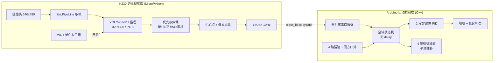

# 零件分拣机器人系统设计与实现

> **Parts Sorting Robot** · 基于「K230 边缘视觉 + Arduino 运动控制」双核异构架构的自主零件分拣机器人
>
> 从 **数据采集 → Roboflow 标注 → 本地 YOLOv8 训练 → NNCase 量化部署 → 板端推理 → 底盘/机械臂闭环控制** 的完整工程闭环

[](LICENSE)


---

## 📖 项目简介

本项目是一套面向自动化工业 / 竞赛场景的**自主零件分拣机器人系统**，能够在无人干预下完成对三种几何体零件（正方体、圆柱体、正三棱柱）的**视觉识别、优先级决策、精准抓取、循迹搬运、定点投放与自动泊车入库**的完整闭环。

系统采用**双核心异构协同架构**：

| 层次 | 硬件 | 职责 |
| :--- | :--- | :--- |
| 边缘视觉计算层 | 嘉楠 Kendryte **K230**（CanMV / MicroPython） | 端侧 YOLOv8 目标检测、中心坐标计算、距离比例特征提取、串口推流 |
| 运动与位姿控制层 | **Arduino**（AVR，C++） | 双路电机差速控制、四路红外循迹闭环、四自由度机械臂运动学执行 |

```
起点视觉对准抓取 → 黑线爆发直冲 → 动态 PID 巡线与侧向投递 → 闭环特征点直角弯 → 五步法泊车入库 → 起点复位
```

## 🏗️ 系统架构



## ✨ 核心技术亮点

### 视觉侧（K230）
- **物理特征工程**：黑色防眩光垫子 + 侧上方打光，解决白色正方体过曝漏检难题，实现 0.65 高置信度阈值下**零虚警**。
- **顶面标注法**：只标注工件顶面平面图元，使检测框几何中心恒等于垂直抓取轴心，破解「抓取中心点漂移」。
- **端侧 INT8 量化部署**：YOLOv8n 经 NNCase 量化编译为 `.kmodel`，跑在 K230 硬件 KPU/NPU 上。
- **像素占比测距**：`pixel_ratio = (w*h)/(640*480)` 作为机械臂近距盲区的粗测距指标。
- **硬件看门狗自愈**：5 秒 WDT + 全局异常捕获，长期无人值守不死机。

### 控制侧（Arduino）
- **全域非阻塞状态机**：主循环零 `delay()`，刷新率 300Hz+，机械臂插补恒定周期流转。
- **非阻塞串口协议**：字符级流式缓存 + 行终止符判断，杜绝半截数据帧损坏。
- **低电量静摩擦破死区**：`DEADZONE_PWM = 115` 下限截断 + 转弯切入瞬时启动脉冲。
- **五步闭环泊车法**：靠传感器跳变自动推进的转弯回正序列，摆脱盲转计时误差。
- **正方体漏抓深度重试**：抓取后 800ms 验证窗口，漏抓自动切换 `RATIO_CUBE_RETRY = 16.6` 深抓。
- **红外投递防误触**：9 秒起步盲区屏蔽 + 投放后双重防重触发门禁。

## 📁 目录结构

```
parts-sorting-robot/
├── README.md                          # 项目主说明（本文件）
├── LICENSE                            # MIT 开源协议
├── .gitignore
├── docs/
│   └── 系统技术全景与开发复盘.md       # 架构、参数矩阵、六阶段攻关历程
├── arduino/
│   └── robot_chassis_controller/
│       └── robot_chassis_controller.ino  # 底盘 + 机械臂主控固件（完整状态机）
├── k230/
│   ├── main.py                        # K230 视觉推理主程序（含 WDT 自愈）
│   └── kmodel/
│       └── README.md                  # 模型部署与标签约束说明
└── train/
    ├── README.md                      # 训练与量化全流程指南
    ├── requirements.txt               # 本地 PC 端训练依赖
    ├── data.yaml.example              # Roboflow 数据集配置模板
    └── run_convert.sh                 # Docker 内一键量化脚本
```

## 🚀 快速开始

### 1. Arduino 编译烧录
1. 安装 Arduino IDE，安装第三方库 `ServoTimer2`。
2. 打开 `arduino/robot_chassis_controller/robot_chassis_controller.ino`。
3. 选择 AVR 板卡（Uno / Nano / Mega / Basra），编译上传。

### 2. K230 模型与脚本部署
1. 参考 `train/README.md` 完成「Roboflow 标注 → 本地训练 → Docker 量化」得到 `best.kmodel`。
2. 将 `best.kmodel` 放入 TF 卡 `/kmodel/best.kmodel`。
3. 将 `k230/main.py` 放入 SD 卡根目录（上电自启可另存为 `main.py`）。

### 3. 硬件连线与上电
- K230 串口 TX 交叉接 Arduino RX，**必须共地**，波特率统一 `115200`。
- 电机接 `D5/D6`（右）、`D9/D10`（左）；循迹接 `A3/A4/A0/A2`；舵机接 `D7/D11/D12/D8`；侧方红外接 `D2`。
- 上电后机械臂复位至预备姿态，K230 开始推流，机器人自主完成分拣循环。

## 🖼️ 演示效果

> 建议在此处补充实机演示照片 / 视频（拍摄机器人循迹抓取、定点投放、泊车入库的过程），能显著提升项目展示效果。可将图片放入 `docs/assets/` 并在下方引用。

```markdown

```

## 📚 参考链接

- [Ultralytics YOLOv8](https://github.com/ultralytics/ultralytics) · [文档](https://docs.ultralytics.com)
- [Roboflow](https://roboflow.com)（在线标注与数据集导出）
- [Canaan Kendryte nncase](https://github.com/kendryte/nncase)（K230 模型量化编译器）
- [K230 CanMV 文档](https://github.com/kendryte/k230_canmv_docs)

## 📄 许可

本项目采用 [MIT License](LICENSE) 开源。
